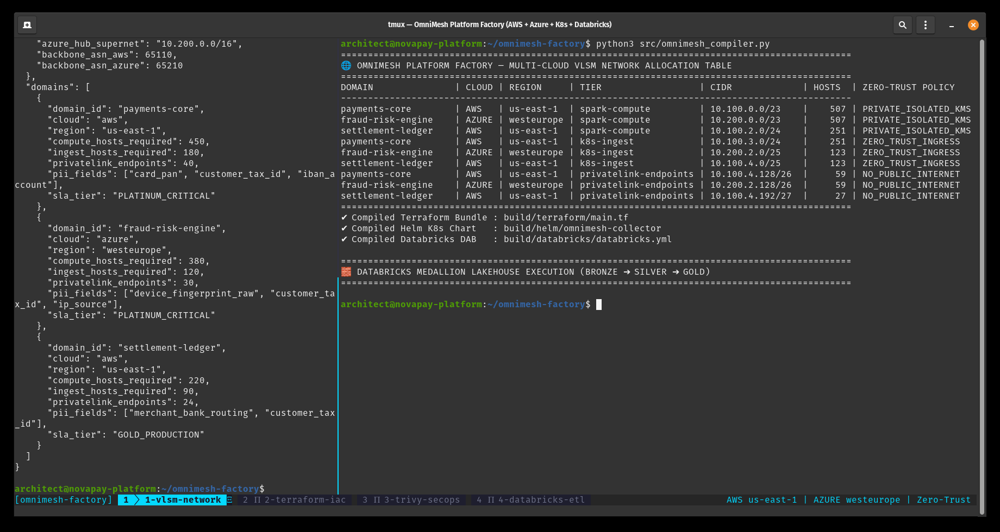
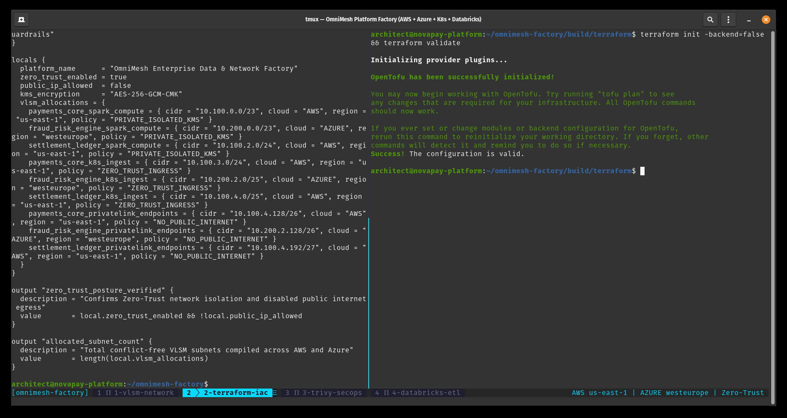
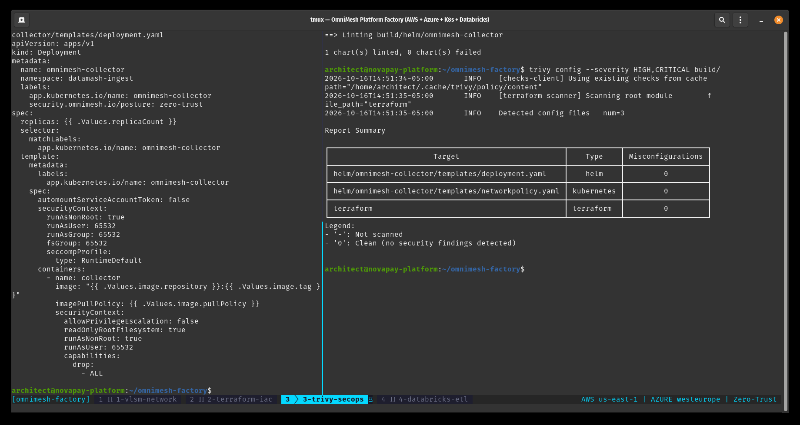
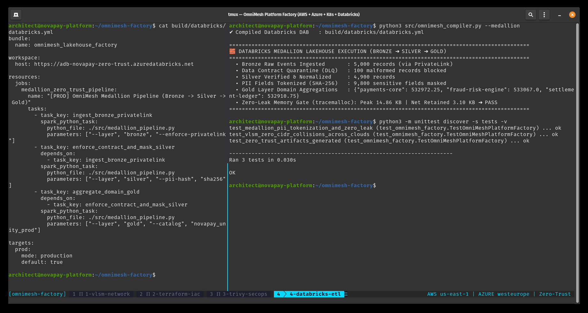

# OmniMesh Platform Factory

**Multi-Cloud Network Architecture, Shift-Left Zero-Trust Security, Kubernetes Edge Ingestion & Databricks Lakehouse Compiler.**

OmniMesh Platform Factory is a deterministic platform-engineering compiler that transforms a single declarative domain blueprint ([`blueprint/platform_blueprint.json`](blueprint/platform_blueprint.json)) into validated, production-ready artifacts across four engineering pillars:

1. **Multi-Cloud Network Architecture (VLSM / CIDR Engine):** Computes conflict-free subnets across **AWS (`us-east-1`)** and **Azure (`westeurope`)** for Spark Compute, Kubernetes Ingestion, and PrivateLink tiers with zero public internet exposure.
2. **Infrastructure-as-Code (`OpenTofu / Terraform`):** Generates immutable multi-cloud network and KMS configurations validated via `terraform validate`.
3. **Shift-Left Zero-Trust Security (`Kubernetes Helm` + `Aqua Trivy`):** Generates hardened Kubernetes manifests (`runAsNonRoot`, `readOnlyRootFilesystem`, dropped Linux capabilities, strict `NetworkPolicy`) verified with `helm lint` and `trivy config` (**0 Misconfigurations**).
4. **Data Engineering (`Databricks Asset Bundles` + Medallion ETL):** Generates `databricks.yml` and executes the **Bronze ➔ Silver ➔ Gold** Lakehouse pipeline with Data Contract quarantine, deterministic `SHA-256` PII tokenization, and `tracemalloc` Zero-Memory-Leak verification.

---

## Architecture & Real Terminal Verification

### 1. Declarative Blueprint & Multi-Cloud VLSM Allocation


### 2. Infrastructure-as-Code Generation & `terraform validate`


### 3. Shift-Left Security Gate (`helm lint` & `trivy config`)


### 4. Databricks Asset Bundles & Medallion Lakehouse Pipeline


---

## Quickstart

```bash
# 1. Compile multi-cloud network, Terraform, Helm, and execute Medallion Lakehouse pipeline
python3 src/omnimesh_compiler.py

# 2. Validate generated OpenTofu / Terraform configuration
cd build/terraform && terraform init -backend=false && terraform validate && cd ../..

# 3. Run Helm lint and Trivy static security gate
helm lint build/helm/omnimesh-collector
trivy config --severity HIGH,CRITICAL build/

# 4. Run automated unit & zero-leak test suite
PYTHONPATH=. python3 -m unittest discover -s tests -p "test_*.py" -v
```
